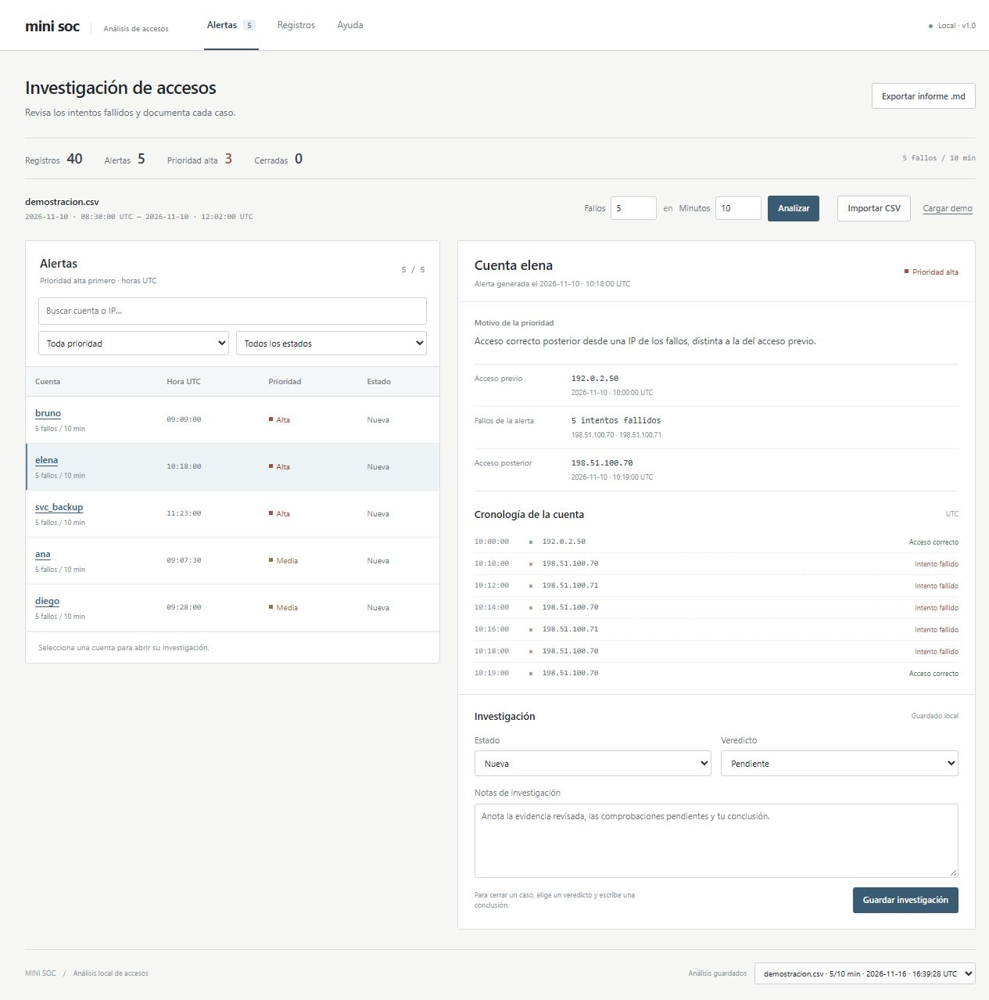

# Mini SOC

Herramienta local para analizar registros de acceso, detectar intentos fallidos repetidos y documentar la investigación de cada alerta.

Python 3.11+ · SQLite · JavaScript · HTML/CSS



## Puesta en marcha

Necesitas Python 3.11 o posterior. La aplicación utiliza la biblioteca estándar; no hay paquetes que instalar.

```shell
git clone https://github.com/Pumcheese/mini-soc.git
cd mini-soc
python app.py
```

En Windows también puedes ejecutar `py -3 app.py` o `.\iniciar.ps1`.

Abre [http://127.0.0.1:8765](http://127.0.0.1:8765/). Mantén la terminal abierta y pulsa Ctrl+C para detener el servidor.

El primer arranque carga una demostración con 40 registros de siete cuentas ficticias. Con la regla inicial de cinco fallos en diez minutos aparecen cinco alertas: tres de prioridad alta y dos de prioridad media.

Para cambiar el puerto, elegir dónde guardar los datos o mostrar las peticiones HTTP:

```shell
python app.py --port 8766
python app.py --data-dir ./mis-datos
python app.py --verbose
```

## Uso

1. Carga la demostración o importa un CSV.
2. Ajusta el número de fallos y los minutos de la ventana. Pulsa **Analizar**.
3. Selecciona una alerta y compara el acceso previo, los fallos y los accesos posteriores.
4. Guarda tus notas, el estado del caso y el veredicto. Para cerrar un caso necesitas una conclusión.
5. Exporta el informe Markdown.

Puedes buscar por cuenta o IP, filtrar alertas y consultar los registros importados. El selector **Análisis guardados** recupera las investigaciones anteriores.

## Formato del CSV

Archivo UTF-8 con esta cabecera y en este orden:

```csv
fecha_utc,usuario,ip_origen,resultado
2026-11-10T09:00:00Z,ana,192.0.2.10,FALLO
2026-11-10T09:01:00Z,ana,192.0.2.10,EXITO
```

Las fechas deben incluir zona horaria. Se admiten IPv4, IPv6 y los resultados `EXITO` y `FALLO`. Los eventos se ordenan y las fechas se convierten a UTC. El límite es de 2.000 eventos y 2 MB por petición, incluido el cuerpo JSON.

Las filas repetidas cuentan en la regla y generan un aviso. No se eliminan automáticamente, porque podrían corresponder a accesos distintos. Un archivo inválido no reemplaza el análisis abierto.

## Cómo se interpretan las alertas

La regla cuenta los fallos de cada usuario dentro de la ventana configurada, aunque cambie la IP. Un acceso correcto intermedio no reinicia el contador.

La prioridad es **alta** si hay un éxito posterior desde una IP de los fallos distinta de la del último éxito previo. Se revisan todos los éxitos de la ventana posterior. Los demás casos tienen prioridad **media**, con el motivo indicado en el panel.

Una alerta es un motivo para investigar. Una IP diferente puede deberse a una VPN o a un cambio de red; la prioridad no confirma una intrusión.

Consulta [los escenarios de ejemplo](docs/escenarios.md) y [el funcionamiento de la regla y el almacenamiento](docs/funcionamiento.md).

## Datos y alcance

Los análisis y las decisiones se guardan en `.local/mini-soc.sqlite3`. Repetir los mismos eventos con la misma regla recupera sus investigaciones. Antes de actualizar una instalación con datos guardados, detén el servidor y conserva una copia de la base.

La aplicación está pensada para uso individual en el equipo que la ejecuta:

- No recoge logs en directo ni bloquea accesos. Tampoco tiene autenticación multiusuario. No expongas el puerto a una red compartida o a Internet.
- La regla no cubre todos los ataques: por ejemplo, intentos lentos o repartidos entre muchas cuentas.
- Cada cronología muestra hasta 100 eventos y avisa si se recorta. En **Registros** está el conjunto importado completo.
- Se conserva la última versión de las notas; no hay historial inmutable ni cadena de custodia.
- SQLite no tiene cifrado integrado. La protección de los archivos depende de los permisos del sistema operativo.

La demostración utiliza datos ficticios. Si importas registros propios, anonimízalos y revisa los informes antes de compartirlos.

## Pruebas

```shell
python -B -m unittest discover -s tests -v
```

Las pruebas cubren detección, validación, persistencia, guardados simultáneos y API. GitHub Actions las ejecuta en Windows y Linux con Python 3.11 y 3.13. [Ver ejecuciones](https://github.com/Pumcheese/mini-soc/actions).

Si tienes Node instalado, puedes comprobar la sintaxis de JavaScript con `node --check web/app.js`. Node no es necesario para ejecutar la aplicación.

## Estructura

```text
app.py                 Servidor HTTP e informes
almacen.py             Persistencia en SQLite
detectar_alertas.py    Regla de fallos por cuenta
investigar_alertas.py   Validación y contexto de las alertas
leer_accesos.py         Consulta del CSV reducido por terminal
web/                   Interfaz HTML, CSS y JavaScript
datos/                 Registros ficticios
tests/                 Pruebas automatizadas
docs/                  Captura y documentación
.github/workflows/     Comprobaciones de GitHub Actions
```

La regla también puede ejecutarse por terminal con `python detectar_alertas.py`. El archivo `datos/accesos.csv` contiene un ejemplo reducido de 16 registros.

## Licencia

El repositorio no incluye una licencia de reutilización.
